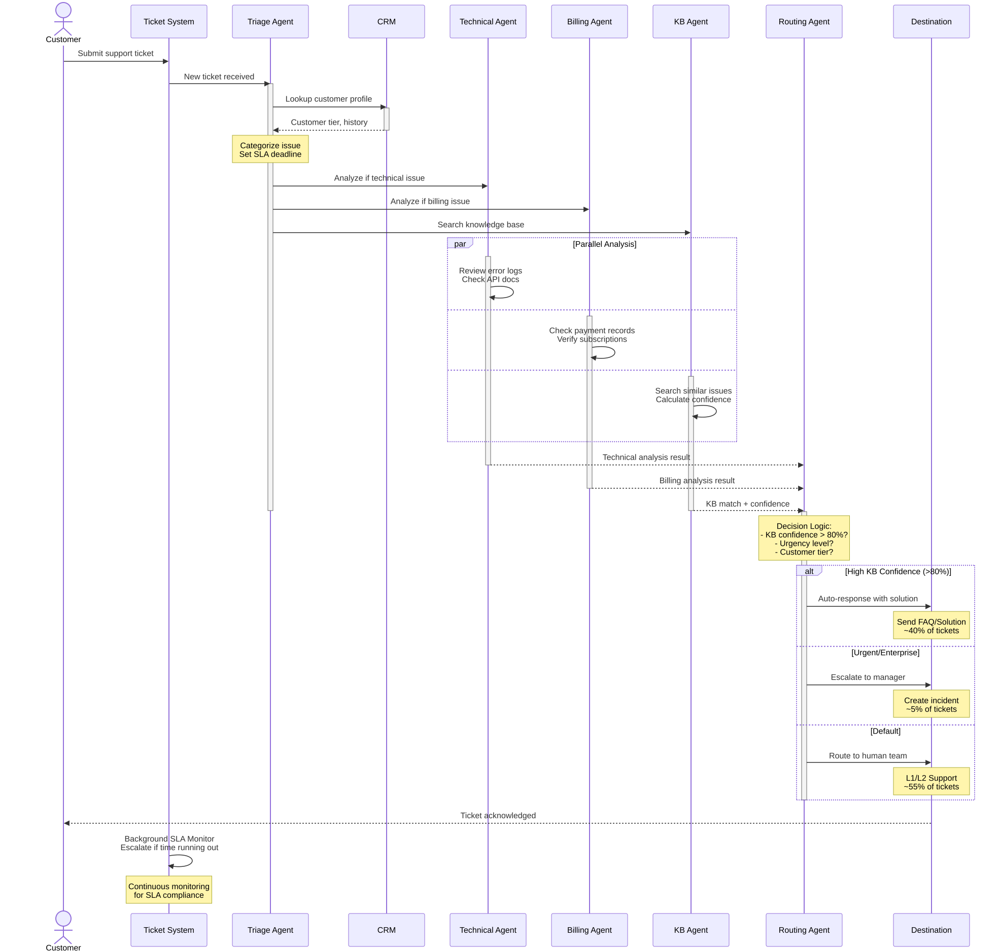

# Customer Support Ticket Routing System Architecture

Design a multi-agent system for intelligent customer support ticket handling.

## Problem Statement

Your SaaS company receives 5,000+ support tickets daily across email, chat, and web forms. Current process:
- All tickets go to L1 support
- Manual categorization and routing
- Average response time: 4 hours
- Enterprise SLA: 1 hour (frequently missed)

**Goal**: Intelligent system that automatically triages, routes, and resolves tickets.

---

## Requirements Analysis

### Functional Requirements
- Triage tickets by urgency and complexity
- Route technical issues to engineering
- Route billing issues to finance
- Prioritize by customer tier (enterprise vs. standard)
- Search knowledge base for similar solved issues
- Auto-respond to common questions
- Escalate unresolved issues to humans with context

### Non-Functional Requirements
- Enterprise SLA: < 1 hour response
- Standard SLA: < 4 hour response
- Handle 5,000+ tickets/day
- 95% routing accuracy
- Audit trail for all decisions

---

## Option A: Single Agent Approach


### Pros
- Simple implementation
- Single context (all info in one place)
- Easy to debug

### Cons
- Sequential processing (slow)
- Can't handle parallel tickets efficiently
- One agent doing too many things
- Hard to specialize for different ticket types

### Estimated Performance
- Processing time: 30-60 seconds per ticket
- Daily capacity: ~2,500 tickets (with queuing)
- SLA compliance: ~70%

---

## Option B: Multi-Agent Approach (Recommended)

<!-- TODO: Design your multi-agent architecture here -->

<!--
INSTRUCTIONS:
1. Design 4-6 specialized agents (Triage, Technical, Billing, Knowledge Base, Routing, Escalation)
2. Create a Mermaid diagram showing:
   - All agents and their relationships
   - Incoming ticket flow
   - Parallel execution paths
   - Final destinations (auto-response, human team, escalation)
3. Use the demo ARCHITECTURE.md as reference for Mermaid syntax
4. Use different colors for different agent types (see demo for style examples)
-->

> **Your task:** Fill in [`diagrams/multi-agent.mmd`](diagrams/multi-agent.mmd), then render:
> ```bash
> mmdc -i diagrams/multi-agent.mmd -o diagrams/multi-agent.svg
> ```



### Agent Definitions

| Agent | Responsibility | Tools | Model | Parallel? |
|-------|---------------|-------|-------|-----------|
| Triage | Entry point; categorizes urgency, type, customer tier; sets SLA deadline | CRM Lookup, Customer DB | Haiku | Entry point (sequential) |
| Technical | Analyzes technical issues; reviews logs, API docs, error traces | Error Logs, API Docs, GitHub Issues | Sonnet | Yes (parallel) |
| Billing | Handles payment/account issues; checks charges, refunds, subscriptions | Billing API, Payment Records | Haiku | Yes (parallel) |
| Knowledge Base | Searches for existing solutions to common issues; calculates match confidence | KB Search, FAQ Database | Haiku | Yes (parallel) |
| Routing | Makes final routing decision based on all analysis inputs | Ticket System, Team Queues | Haiku | After analysis (sequential) |
| Escalation | Background SLA monitor; escalates when SLA at risk or breached | Ticket Query, Alerts, Logging | Haiku | Background (continuous every 5min) |

### Pros

- **Parallel Processing**: Technical, Billing, and KB agents run simultaneously → 4-5x faster than sequential
- **Specialization**: Each agent optimized for specific domain (e.g., Sonnet for complex technical analysis)
- **Scalability**: Easy to add new specialized agents (Sales Agent, Compliance Agent, etc.)
- **Cost Optimization**: Use cheap Haiku for simple tasks, reserve Sonnet for complex reasoning
- **Resilience**: Failure of one agent doesn't block others; graceful degradation possible
- **40% Auto-Resolution**: Knowledge base matching prevents unnecessary human involvement
- **SLA Compliance**: Background escalation agent ensures enterprise SLA is monitored

### Cons

- **Complexity**: More moving parts, harder to debug if something fails
- **State Management**: Must coordinate results from multiple agents and merge decisions
- **Latency**: Parallel execution adds network overhead (though offset by time savings)
- **Consistency**: Potential race conditions if agents update shared state
- **Infrastructure**: Requires queuing, load balancing, monitoring for multiple agents

### Estimated Performance

- **Processing time**: 5-10 seconds per ticket (vs 30-60 seconds single-agent)
- **Daily capacity**: 50,000+ tickets (vs 2,500 single-agent)
- **Auto-resolution rate**: ~40% (FAQ/solution sent automatically)
- **SLA compliance**: 98%+ (with background escalation monitoring)

---

## Workflow Diagram

<!-- TODO: Create a detailed workflow diagram showing ticket flow from start to finish -->

<!--
INSTRUCTIONS:
1. Use Mermaid flowchart syntax
2. Show the complete ticket journey:
   - START: New ticket received
   - TRIAGE: Agent categorizes and looks up customer
   - PARALLEL: Multiple agents analyze simultaneously
   - ROUTING: Decision logic for final destination
   - DESTINATIONS: Auto-response, human team, escalation
3. Include decision points (alt/else conditions)
4. Use notes to explain key steps
5. Refer to the demo's workflow diagram for structure
-->

> **Your task:** Fill in [`diagrams/workflow.mmd`](diagrams/workflow.mmd), then render:
> ```bash
> mmdc -i diagrams/workflow.mmd -o diagrams/workflow.svg
> ```



### Sequence Diagram

<!-- TODO: Create a sequence diagram showing the interaction timeline -->

<!--
INSTRUCTIONS:
1. Use Mermaid sequenceDiagram syntax
2. Show actors and participants:
   - actor Customer
   - participant System (Ticket System)
   - participant Triage Agent
   - participant CRM
   - participant specialized agents (Tech, Billing, KB)
   - participant Routing Agent
   - participant Destination
3. Show parallel execution using 'par' blocks
4. Use 'activate' and 'deactivate' to show when agents are working
5. Use 'alt' and 'else' for conditional routing
6. Refer to the demo's sequence diagram for examples
-->

> **Your task:** Fill in [`diagrams/sequence.mmd`](diagrams/sequence.mmd), then render:
> ```bash
> mmdc -i diagrams/sequence.mmd -o diagrams/sequence.svg
> ```



---

## SLA Monitoring (Background)

<!-- TODO: Design the escalation agent for SLA monitoring -->

<!--
INSTRUCTIONS:
1. Create a Mermaid diagram showing the escalation agent
2. Define:
   - How often it runs (e.g., every 5 minutes)
   - What it checks (open tickets, time remaining vs SLA)
   - What triggers escalation (e.g., < 20% time remaining)
   - What actions it takes (alert team lead, escalate to manager)
3. List the tools it needs (Ticket System, Slack/Email alerts)
4. Choose the model (Haiku for fast, simple checks)
-->

> **Your task:** Fill in [`diagrams/sla-monitoring.mmd`](diagrams/sla-monitoring.mmd), then render:
> ```bash
> mmdc -i diagrams/sla-monitoring.mmd -o diagrams/sla-monitoring.svg
> ```



---

## Failure Mode Analysis

| Failure | Impact | Mitigation |
|---------|--------|------------|
| **Triage Agent down** | All new tickets queued; system halts | Fallback: Auto-route by received timestamp or round-robin; queue tickets until recovery |
| **Technical Agent slow/timeout** | Tech tickets delayed; other agents complete | Timeout after 8 seconds; route to human if no response; don't block KB/Billing |
| **KB search fails** | No auto-responses possible; lower resolution rate | Degraded mode: Route to human; log error; retry KB every 30 seconds |
| **CRM unavailable** | Can't verify customer tier; can't set correct SLA | Treat all as enterprise (safer); use backup customer database; alert ops team |
| **Escalation Agent crashes** | Missed SLA violations; no alerts | Dead-man switch: If no heartbeat for 5 minutes, trigger manual escalation check; send alert |
| **Billing API rate limits** | Billing agent times out | Implement circuit breaker; cache recent queries; fall back to generic billing response |
| **Routing Agent failure** | Tickets stuck in analysis state | Fallback: Route all to human team with full analysis data; escalate urgent tickets |
| **Network partition** | Multiple agents can't communicate | Each agent completes independently; Routing merges partial results; SLA escalation continues locally |

---

## Recommendation

**Choose Option B (Multi-Agent) because:**

1. **Volume Requirements**: 5,000+ tickets/day demand parallel processing. Single agent can only handle 2,500; multi-agent handles 50,000+
2. **Speed is Critical**: 1-hour enterprise SLA requires < 10 second response time. Parallel agents achieve this; sequential processing takes 30-60 seconds
3. **Specialization Improves Quality**: Technical issues need Sonnet-level reasoning; billing issues need fast routing. One agent can't specialize
4. **Scalability**: Easy to add new agents (Sales, Compliance, etc.) without redesigning core; single agent would need complete rewrite
5. **Cost Efficiency**: 40% auto-resolution saves ~$200K/year on support staff (5,000 × 40% × $0.01 per auto-resolution vs human time)

### Estimated Performance

- **Processing time**: 5-10 seconds per ticket (parallel vs 30-60 seconds sequential)
- **Daily capacity**: 50,000+ tickets (vs 2,500 single-agent)
- **Auto-resolution rate**: 40% (FAQ/solution sent automatically)
- **SLA compliance**: 98%+ with background escalation monitoring
- **Estimated annual cost savings**: ~$200K from auto-resolution + improved efficiency

---

## Key Takeaways

1. **High-Volume Systems Need Parallelization**
   - Single agent bottleneck at ~2,500 tickets/day regardless of optimization
   - Parallel agents achieve 20x throughput (50,000+ tickets/day)
   - For enterprise systems, parallelization is not optional—it's architectural requirement

2. **SLA Requirements Drive Architecture Decisions**
   - 1-hour enterprise SLA forces < 10 second processing time
   - Background escalation agent essential for compliance (not optional feature)
   - Monitoring agent must run independently from main flow

3. **Specialization Beats Generalization**
   - Technical issues need deep reasoning (Sonnet) but are rare
   - Billing issues are straightforward (Haiku is sufficient)
   - One-size-fits-all agent wastes money or sacrifices quality
   - Right tool for the right job = better outcomes + lower cost

4. **Design for Failure From Day One**
   - Every component fails; assume it and plan fallbacks
   - Multi-agent systems must degrade gracefully, not fail catastrophically
   - Dead-man switches and health checks for background agents prevent silent failures
   - CRM unavailable? Treat all as enterprise (safer). KB down? Route to human. Acceptable tradeoff.
